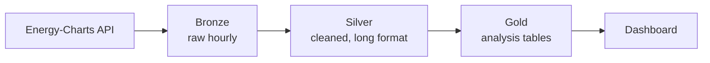

# Belgian Grid Analytics

Automated daily pipeline tracking Belgium's electricity mix since 2021, built with **PySpark**, **Delta Lake** and **Databricks** (medallion architecture).

Source: [Energy-Charts API](https://api.energy-charts.info/) (Fraunhofer ISE), hourly generation data for Belgium, CC BY 4.0.

## Architecture

| Notebook | Role |
|---|---|
| `00_initial_backfill` | One-off load of the full history |
| `01_bronze_ingestion` | Incremental ingestion, `MERGE`, quality check |
| `02_silver_cleaning` | Cleaning, wide → long, categories, imputation |
| `03_gold_aggregation` | Daily, monthly and yearly mix, daily balance, hourly profiles |
| `04_data_checks` | Validation queries |

A Databricks job runs `01 → 02 → 03` every day at 07:00 (Brussels time).

## Key decisions

- **Incremental and idempotent:** each run re-fetches a 7-day lookback window and writes it with a Delta `MERGE`. No duplicates, missed runs and late-arriving values are caught up automatically.
- **Quality check:** the job fails if bronze has duplicate or missing hours.
- **UTC storage:** timestamps are stored in UTC and converted to Belgian time only for daily cuts and display.
- **Generation scope:** storage and cross-border exchanges are excluded from generation shares.
- **Nuclear gaps:** no nuclear data was published for May, June, August and September 2026, while both reactors were offline. These values are set to 0 and flagged (`is_imputed`).

## Validation against Elia

| | 2024: pipeline | 2024: Elia | 2025: pipeline | 2025: Elia |
|---|---|---|---|---|
| Nuclear | 29.7 TWh | ~30 TWh | 22.6 TWh | 22.5 TWh |
| Total generation | 71.4 TWh | ~71 TWh | 67.7 TWh | ~66 TWh |
| Nuclear share | 41.7% | 42% | 33.4% | 34% |

Nuclear, wind, solar and totals match within 1–3%. Gas is higher than Elia's figure, likely due to a different classification of some units (e.g. cogeneration).

## Results

- Renewable share of consumption: **23% (2021) → 33.6% (2026)**
- Summer 2025 solar peak: almost **5 GW** on average at 13:00
- 2026 nuclear restart captured day by day: first unit back from 14 October, both units at full power from 1 November

## Stack

Databricks Free Edition · PySpark · Delta Lake · SQL · Python (requests, pandas) · GitHub

## Limitations

- Small volume (~51,000 hourly rows): Spark is used for scalability and practice, not out of necessity.
- Free Edition has no SLA; a skipped run is caught up by the next one.
- Silver and gold are fully rebuilt on each run.

## Author

Ayoub El Habsati · [GitHub](https://github.com/Ayoub0ELH) · [LinkedIn](https://linkedin.com/in/ayoub-el-habsati)